## 🛡️ About Me
- 🎓 B.Tech CSE (Cyber Security) student at **IIIT Kottayam**
- 🔬 Cybersecurity Research Intern at **RV University**: Transformer-based adaptive intrusion detection
- 🧩 **2 merged PRs** in Rapid7's [Metasploit Framework](https://github.com/rapid7/metasploit-framework): [#21882](https://github.com/rapid7/metasploit-framework/pull/21882) and [#21947](https://github.com/rapid7/metasploit-framework/pull/21947)
- 🐞 Bugcrowd researcher: found a client-side game-logic flaw in the HackWithIndia VDP
- 📜 Working toward **CEH v13**

## 🚀 Featured Projects
| Project | Description | Stack |
|---|---|---|
| **Visor** (in progress) | Chrome MV3 extension that detects AiTM reverse-proxy phishing (Evilginx) and IDN homograph domains on-device. Decision Tree reaches **0.982 ROC-AUC**, **94.6% recall**, 1.41 ms overhead | JavaScript, Python, Scikit-learn, Playwright, Azure |
| **WebSentry** | Modular OWASP Top 10 scanner (SQLi, XSS, CSRF, IDOR, Open Redirect) with CVSS-based JSON reports | Python, Requests, BeautifulSoup |
| **AI-Driven Adaptive IDS** | ML-based IDS on CICIDS2017 (2.8M+ flows) that classifies 8+ attack categories | Python, Pandas, Scikit-learn |

## 🧰 Toolbox

**Web/API:** Burp Suite, OWASP ZAP, SQLMap, FFUF, Gobuster, Nuclei, Nikto, Postman
**Network/Recon:** Nmap, Wireshark, Metasploit, Amass, Subfinder
**DFIR:** Magnet AXIOM, Autopsy, FTK Imager, ExifTool

## 📊 GitHub Stats

